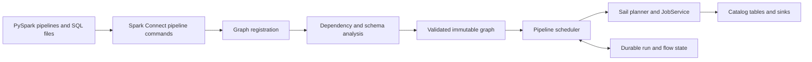

# Sail Declarative Pipelines

Implement Apache Spark 4.2.1 Declarative Pipelines (SDP) as a Rust control layer
above Sail's existing planner, catalog providers, and execution service. Keep
the upstream `pyspark.pipelines` API and Spark Connect client: users should be
able to point `spark-pipelines run --remote sc://…` at Sail.

The compatibility target is Spark **4.2.1**, tag commit
`617618396087429b5627a86ce933bb0f5d6645cb`. The Sail starting point is
`0ba425c0331aee4dd4e9a280c6a793926fd0876e`. This is an implementation design;
the presence of a feature below does not establish that it is implemented.

## What Spark supplies

SDP registers dataset definitions and flows, resolves their dependencies, then
executes a graph. Materialized views publish batch query results. Streaming
tables receive incremental writes from one or more flows. Temporary views are
logical intermediates scoped to the pipeline. Sinks write to external systems.
The project spec supplies source globs, a storage URI, catalog/database defaults,
and SQL configuration. Python and SQL definitions can be mixed.

Spark 4.2.1 adds more than the initial 4.1 surface: injected `spark` bindings in
Python definitions, Auto CDC SCD Type 1, clustering metadata, and structured
identifiers in the protocol matter for compatibility. Source of truth:
[the versioned programming guide](https://github.com/apache/spark/blob/v4.2.1/docs/declarative-pipelines-programming-guide.md),
[Python API](https://github.com/apache/spark/blob/v4.2.1/python/pyspark/pipelines/api.py),
and [protocol](https://github.com/apache/spark/blob/v4.2.1/sql/connect/common/src/main/protobuf/spark/connect/pipelines.proto).

Protocol declarations alone are not implemented behavior. Spark 4.2.1's
[PipelinesHandler](https://github.com/apache/spark/blob/v4.2.1/sql/connect/server/src/main/scala/org/apache/spark/sql/connect/pipelines/PipelinesHandler.scala)
dispatches create/drop graph, define output/flow/SQL, and start run. It does not
dispatch the declared deferred query-function signal/result commands or
`ExecuteOutputFlows`. Match the shipped client/server first; track those
additional protocol methods separately.

Spark's implementation uses graph-wide analysis before execution, enforces
streaming/batch flow types, merges incoming schemas, detects cycles and
duplicate names, and isolates per-flow configuration. A materialized view
refresh can recompute its batch query; accepting its declaration does not imply
incremental view maintenance. See
[graph validation](https://github.com/apache/spark/blob/v4.2.1/sql/pipelines/src/main/scala/org/apache/spark/sql/pipelines/graph/GraphValidations.scala)
and [graph resolution tests](https://github.com/apache/spark/blob/v4.2.1/sql/pipelines/src/test/scala/org/apache/spark/sql/pipelines/graph/ConnectValidPipelineSuite.scala).

## Sail integration

| Existing component | Reuse and required change |
| --- | --- |
| `sail-spark-connect` protocol and service | Replace the pipeline-command rejection with graph lifecycle and run handlers. Return typed command results and pipeline events through the existing execution response stream. |
| `SparkSession` | Own ephemeral graph registrations and cancellation handles. Keep graph state separate from durable run/checkpoint state. |
| `sail-sql-parser` and `sail-sql-analyzer` | Parse pipeline SQL into definitions without executing DDL during registration. Support pipeline-only syntax in an explicit entry point. |
| `sail-plan::PlanResolver` | Add a request-local relation scope for pipeline outputs. Resolve forward references without publishing placeholders into the session catalog. |
| `CatalogManager` and table writers | Publish actual outputs with their schema, format, properties, partitioning, and clustering. Use existing provider operations and transactional lakehouse commits. |
| `JobService` | Execute each ready flow using local or distributed Sail execution. The pipeline scheduler orders flows; the existing scheduler still orders query stages and tasks. |
| Grust graph algorithms | Reuse iterative topological ordering and concrete cycle witnesses. Extract the dense-index kernel behind a small dependency boundary; do not bring graph stores, Arrow adapters, or the Grust Sail adapter into Sail. |
| LakeCat commit replay and outbox | Reuse compare-and-swap, idempotency records, and transactional side-effect delivery through a small control-state boundary. Keep pipeline progress outside Iceberg table metadata. Do not depend on `lakecat-sail` from Sail, which would create a dependency cycle. |
| Streaming sources and writes | Add replayable source progress, bounded available-data runs, sink commits, and restart recovery. Existing streaming query handles alone do not supply SDP checkpoint semantics. |

Start with a `pipelines` module in `sail-spark-connect`, with registration,
analysis, execution, SQL, and persistence in separate modules. Convert incoming
relations to Sail specs at the boundary. Extract a transport-independent crate
when a second frontend needs it; do not make the planner depend on Spark
protobufs.

## Semantic contract

1. **Registration is declarative.** Retain origin, declared output kind, format,
   schema, partitioning/clustering, properties, flow name, target, query, and
   configuration. Parse identifiers into components; never split on dots inside
   quoted identifiers. Graph IDs are session-owned UUIDs. Persistent flow
   identity must not use those ephemeral UUIDs.
2. **Analysis is isolated.** Bind graph-local names before external catalog
   names. Temporary views stay private. Materialized outputs create dependency
   boundaries; view dependencies are expanded transitively. Apply graph and
   flow configuration to resolver instances without mutating another flow's
   session settings. Analyze all flows, including expressions/subqueries, before
   writes. Report direct errors separately from blocked downstream flows.
3. **Dry run has no output writes.** Validate names, schemas, query types,
   dependencies, selection, reset policy, and source/sink capabilities. Metadata
   access needed for analysis is allowed. Do not create tables, advance offsets,
   reset checkpoints, or execute user queries to discover their schemas.
4. **Execution respects dependencies.** A dataset is ready only after all its
   required producer flows succeed. Independent flows may run concurrently.
   Failed producers block consumers; cancellation propagates to active jobs.
   Use bounded concurrency, stable ordering for diagnostics, and terminal run
   events. Dropping a graph stops its work without deleting output tables.
5. **Refresh is explicit.** Match Spark's selection and downstream behavior with
   tests. Normal MV refresh recomputes the batch result. Streaming refresh
   resumes committed progress. Full refresh resets the selected output and its
   associated progress, subject to reset policy. Scala's internal once flows run
   once per checkpoint generation and again after a full refresh; Spark 4.2.1's
   Connect handler rejects any presence of `DefineFlow.once`, including `false`,
   which Sail's Connect handler must match. External sink
   resets cannot promise to remove previously emitted data.
6. **Persistence survives sessions.** Store versioned pipeline/flow state under
   the supplied storage URI, keyed by qualified flow identity and an explicit
   reset generation. Record source ranges, schema/definition compatibility,
   attempt state, and sink commit identity. Enforce a single active writer per
   flow using leases or conditional writes. Session expiry must not erase
   progress or the mapping to published outputs.
7. **Commit order is recoverable.** Persist the intended input range, execute,
   commit to a transactional sink with an idempotency key, then mark progress
   committed. Recovery must distinguish an uncommitted attempt from a committed
   sink whose acknowledgment was lost. A manifest written after an ordinary
   append does not provide exactly-once delivery. Require a persistent catalog
   or persisted output mappings for restart durability.
8. **Auto CDC is stateful.** Implement SCD1 ordering, late updates, deletes,
   tombstones, null handling, column selection, schema evolution, and durable
   auxiliary state according to the 4.2.1 tests. Reuse Sail's MERGE machinery
   only after constructing the correct CDC changes; one MERGE per input batch
   alone is insufficient.

## Delivery and acceptance

The agreed implementation order is **batch, then streaming, then CDC**. Finish
and verify one phase before starting the next phase's implementation. Research
and dependency review may run ahead of that order. Each phase is a sequence of
small local commits with a stated review boundary and source-specific evidence;
the phase names are not intended as single commits.

1. **Batch:** finish registration, SQL and Python definitions, graph analysis,
   declared schema and catalog metadata publication, persisted/private views,
   selection, lifecycle, events, cancellation, and batch error semantics. Map
   applicable Spark 4.2.1 cases to Sail tests, including failure before any
   output writes. Verify local and distributed execution through Sail's normal
   planner and `JobService`.
2. **Streaming:** add reusable replayable source ranges, durable run state,
   transactional sink progress, bounded available-data runs, append flows,
   reset generations, and recovery. Review and adapt the private
   `lakehq/sail-iggy` work together with the local Apache Iggy SDK. The concrete
   reuse boundaries and gaps are recorded in [STREAMING-REUSE.md](STREAMING-REUSE.md).
   Iggy is the first broker integration for these interfaces; the generic
   checkpoint machinery must not depend on Iggy or its schema registry.
3. **CDC:** build Spark 4.2.1's SCD1 processing on the verified streaming commit
   and recovery contract, with ordering, deletes, tombstones, null behavior,
   schema evolution, and durable auxiliary state tested separately.

| Unit | Deliverable | Acceptance evidence |
| --- | --- | --- |
| Test baseline | Exact upstream checkout, test inventory, reproducible runner | Version/SHA verification; collected test IDs and outcomes; no hidden deselections |
| Registration and validation | Typed protocol responses, graph lifecycle, identifiers, flow validation, dry run | Unmodified PySpark SDP tests plus translated graph validation cases |
| Batch execution | Dependency analysis, private views, MV publication, errors and cancellation | Multi-hop pipelines, forward references, repeated refresh, schema errors, catalog visibility |
| SQL definitions | MV, streaming table, views, flows, `STREAM`, scoped `USE`/`SET`, origins | Spark SQL pipeline cases, including rejected syntax and side effects |
| Incremental execution | Replayable sources, append/once flows, reset and selective refresh, sinks | Multiple runs, source growth, crash windows, cancellation and restart |
| Auto CDC | SCD1 processor and durable target/auxiliary state | Spark Auto CDC suites and crash/replay cases |
| Operational completion | Events, isolation, concurrency, remote execution, documentation | Spark server/event/refresh cases and Sail local/distributed tests |

Run the upstream `python/pyspark/pipelines/tests` suite unchanged against Sail
with `SPARK_CONNECT_TESTING_REMOTE`. These tests include client-only checks;
passing them is necessary but does not establish execution parity. Spark also
has substantial suites under `sql/pipelines/src/test` and
`sql/connect/server/src/test/scala/org/apache/spark/sql/connect/pipelines`.
Scala tests directly instantiate Catalyst and Spark internals, so they cannot
run unchanged inside a Rust server. Maintain an explicit mapping from each
upstream case to a Sail integration or Rust test. Preserve inputs, assertions,
error conditions, and refresh semantics; mark unmapped cases as outstanding.

The completion criterion is every applicable upstream behavior covered and
passing, with exclusions explained individually. Passing only decorator tests,
silently skipping streaming, or substituting Spark execution for Sail does not
meet it. The first usable milestone is batch pipelines; it is not the final
compatibility claim.
