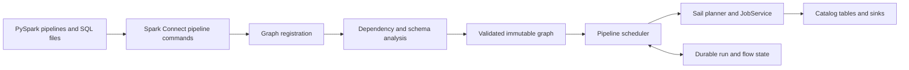

# Sail Declarative Pipelines

Implement Apache Spark 4.2.1 Declarative Pipelines (SDP) as a Rust control layer
above Sail's existing planner, catalog providers, and execution service. Keep
the upstream `pyspark.pipelines` API and Spark Connect client: users should be
able to point `spark-pipelines run --remote sc://…` at Sail.

The compatibility target is Spark **4.2.1**, tag commit
`617618396087429b5627a86ce933bb0f5d6645cb`. The Sail starting point is
`0ba425c0331aee4dd4e9a280c6a793926fd0876e`. This is an implementation design;
the presence of a feature below does not establish that it is implemented.

## What Spark supplies

SDP registers dataset definitions and flows, resolves their dependencies, then
executes a graph. Materialized views publish batch query results. Streaming
tables receive incremental writes from one or more flows. Temporary views are
logical intermediates scoped to the pipeline. Sinks write to external systems.
The project spec supplies source globs, a storage URI, catalog/database defaults,
and SQL configuration. Python and SQL definitions can be mixed.

Spark 4.2.1 adds more than the initial 4.1 surface: injected `spark` bindings in
Python definitions, Auto CDC SCD Type 1, clustering metadata, and structured
identifiers in the protocol matter for compatibility. Source of truth:
[the versioned programming guide](https://github.com/apache/spark/blob/v4.2.1/docs/declarative-pipelines-programming-guide.md),
[Python API](https://github.com/apache/spark/blob/v4.2.1/python/pyspark/pipelines/api.py),
and [protocol](https://github.com/apache/spark/blob/v4.2.1/sql/connect/common/src/main/protobuf/spark/connect/pipelines.proto).

Protocol declarations alone are not implemented behavior. Spark 4.2.1's
[PipelinesHandler](https://github.com/apache/spark/blob/v4.2.1/sql/connect/server/src/main/scala/org/apache/spark/sql/connect/pipelines/PipelinesHandler.scala)
dispatches create/drop graph, define output/flow/SQL, and start run. It does not
dispatch the declared deferred query-function signal/result commands or
`ExecuteOutputFlows`. Match the shipped client/server first; track those
additional protocol methods separately.

Spark's implementation uses graph-wide analysis before execution, enforces
streaming/batch flow types, merges incoming schemas, detects cycles and
duplicate names, and isolates per-flow configuration. A materialized view
refresh can recompute its batch query; accepting its declaration does not imply
incremental view maintenance. See
[graph validation](https://github.com/apache/spark/blob/v4.2.1/sql/pipelines/src/main/scala/org/apache/spark/sql/pipelines/graph/GraphValidations.scala)
and [graph resolution tests](https://github.com/apache/spark/blob/v4.2.1/sql/pipelines/src/test/scala/org/apache/spark/sql/pipelines/graph/ConnectValidPipelineSuite.scala).

## Sail integration

General catalog behavior belongs in Sail: SQL expressions and identifiers,
namespace resolution, metadata validation, view definitions and error transport
must work through Sail's existing catalog interfaces. LakeCat is one supported
catalog adapter. Extend LakeCat for missing provider operations or protocol
coverage; do not move shared SQL semantics into it. Validate shared behavior
against the applicable memory and REST catalog configurations. Extract reusable
LakeCat machinery only where a small dependency boundary is actually needed.

The [catalog-expression design](CATALOG-EXPRESSION-DESIGN.md) defines shared
typed SQL expression resolution and asynchronous preparation followed by locked,
file-atomic pipeline registration. The historical baseline passes thirteen checks
on Spark and two on Sail. Preparation and expression activation are now implemented;
the retained thirteen-case probe now passes on Sail. The
[shared execution-error design](EXECUTION-ERROR-DESIGN.md) has error extraction,
transport, primitive ANSI cast producer/codec and SQL activation implemented.
The broader ordinary-cast probe passes nineteen of twenty-four cases, with five
other cast-family failures retained. Full catalog/batch acceptance remains open. See the [Fable review brief](SDP-FABLE-DESIGN-REVIEW.md)
for the current implementation/evidence snapshot and streaming/CDC draft status.

| Existing component | Reuse and required change |
| --- | --- |
| `sail-spark-connect` protocol and service | Replace the pipeline-command rejection with graph lifecycle and run handlers. Return typed command results and pipeline events through the existing execution response stream. |
| `SparkSession` | Own ephemeral graph registrations and cancellation handles. Keep graph state separate from durable run/checkpoint state. |
| `sail-sql-parser` and `sail-sql-analyzer` | Parse pipeline SQL into definitions without executing DDL during registration. Support pipeline-only syntax in an explicit entry point. |
| `sail-plan::PlanResolver` | Add a request-local relation scope for pipeline outputs. Resolve forward references without publishing placeholders into the session catalog. |
| `CatalogManager` and table writers | Publish actual outputs with their schema, format, properties, partitioning, and clustering. Use existing provider operations and transactional lakehouse commits. |
| `JobService` | Execute each ready flow using local or distributed Sail execution. The pipeline scheduler orders flows; the existing scheduler still orders query stages and tasks. |
| Grust graph algorithms | Reuse iterative topological ordering and concrete cycle witnesses. Extract the dense-index kernel behind a small dependency boundary; do not bring graph stores, Arrow adapters, or the Grust Sail adapter into Sail. |
| LakeCat commit replay and outbox | Reuse compare-and-swap, idempotency records, and transactional side-effect delivery through a small control-state boundary. Keep pipeline progress outside Iceberg table metadata. Do not depend on `lakecat-sail` from Sail, which would create a dependency cycle. |
| Streaming sources and writes | Add replayable source progress, bounded available-data runs, sink commits, and restart recovery. Existing streaming query handles alone do not supply SDP checkpoint semantics. |

Start with a `pipelines` module in `sail-spark-connect`, with registration,
analysis, execution, SQL, and persistence in separate modules. Convert incoming
relations to Sail specs at the boundary. Extract a transport-independent crate
when a second frontend needs it; do not make the planner depend on Spark
protobufs.

## Semantic contract

1. **Registration is declarative.** Retain origin, declared output kind, format,
   schema, partitioning/clustering, properties, flow name, target, query, and
   configuration. Parse identifiers into components; never split on dots inside
   quoted identifiers. Graph IDs are session-owned UUIDs. Persistent flow
   identity must not use those ephemeral UUIDs.
2. **Analysis is isolated.** Bind graph-local names before external catalog
   names. Temporary views stay private. Materialized outputs create dependency
   boundaries; view dependencies are expanded transitively. Apply graph and
   flow configuration to resolver instances without mutating another flow's
   session settings. Analyze all flows, including expressions/subqueries, before
   writes. Report direct errors separately from blocked downstream flows.
3. **Dry run has no output writes.** Match Spark's graph resolution and validation:
   names, schemas, query types, dependencies, selection, and reset policy.
   Metadata access needed for analysis is allowed. On a real run, materialize
   selected table metadata and persisted views before executing data writes.
   A failed materialization or write may leave created or truncated tables;
   Spark does not preflight every publication command as one atomic operation.
   A dry run must not create tables, advance offsets, reset checkpoints, or
   execute user queries to discover their schemas.
4. **Execution respects dependencies.** A dataset is ready only after all its
   required producer flows succeed. Independent flows may run concurrently.
   Failed producers block consumers; cancellation propagates to active jobs.
   Use bounded concurrency, stable ordering for diagnostics, and terminal run
   events. Dropping a graph stops its work without deleting output tables.
5. **Refresh is explicit.** Match Spark's selection and downstream behavior with
   tests. Normal MV refresh recomputes the batch result. Streaming refresh
   resumes committed progress. Full refresh resets the selected output and its
   associated progress, subject to reset policy. Scala's internal once flows run
   once per checkpoint generation and again after a full refresh; Spark 4.2.1's
   Connect handler rejects any presence of `DefineFlow.once`, including `false`,
   which Sail's Connect handler must match. External sink
   resets cannot promise to remove previously emitted data.
6. **Persistence survives sessions.** Store versioned pipeline/flow state under
   the supplied storage URI, keyed by qualified flow identity and an explicit
   reset generation. Record source ranges, schema/definition compatibility,
   attempt state, and sink commit identity. Enforce a single active writer per
   flow using leases or conditional writes. Session expiry must not erase
   progress or the mapping to published outputs.
7. **Commit order is recoverable.** Persist the intended input range, execute,
   commit to a transactional sink with an idempotency key, then mark progress
   committed. Recovery must distinguish an uncommitted attempt from a committed
   sink whose acknowledgment was lost. A manifest written after an ordinary
   append does not provide exactly-once delivery. Require a persistent catalog
   or persisted output mappings for restart durability.
8. **Auto CDC is stateful.** Implement SCD1 ordering, late updates, deletes,
   tombstones, null handling, column selection, schema evolution, and durable
   auxiliary state according to the 4.2.1 tests. Reuse Sail's MERGE machinery
   only after constructing the correct CDC changes; one MERGE per input batch
   alone is insufficient.

## Delivery and acceptance

The agreed implementation order is **batch, then streaming, then CDC**. Finish
and verify one phase before starting the next phase's implementation. Research
and dependency review may run ahead of that order. Each phase is a sequence of
small local commits with a stated review boundary and source-specific evidence;
the phase names are not intended as single commits.

1. **Batch:** finish registration, SQL and Python definitions, graph analysis,
   declared schema and catalog metadata publication, persisted/private views,
   selection, lifecycle, events, cancellation, and batch error semantics. Map
   applicable Spark 4.2.1 cases to Sail tests, including failure before any
   output writes. Verify local and distributed execution through Sail's normal
   planner and `JobService`.
2. **Streaming:** add reusable replayable source ranges, durable run state,
   transactional sink progress, bounded available-data runs, append flows,
   reset generations, and recovery. Review and adapt the private
   `lakehq/sail-iggy` work together with the local Apache Iggy SDK. The concrete
   reuse boundaries and gaps are recorded in [STREAMING-REUSE.md](STREAMING-REUSE.md).
   Iggy is the first broker integration for these interfaces; the generic
   checkpoint machinery must not depend on Iggy or its schema registry.
3. **CDC:** build Spark 4.2.1's SCD1 processing on the verified streaming commit
   and recovery contract, with ordering, deletes, tombstones, null behavior,
   schema evolution, and durable auxiliary state tested separately.

| Unit | Deliverable | Acceptance evidence |
| --- | --- | --- |
| Test baseline | Exact upstream checkout, test inventory, reproducible runner | Version/SHA verification; collected test IDs and outcomes; no hidden deselections |
| Registration and validation | Typed protocol responses, graph lifecycle, identifiers, flow validation, dry run | Unmodified PySpark SDP tests plus translated graph validation cases |
| Batch execution | Dependency analysis, private views, MV publication, errors and cancellation | Multi-hop pipelines, forward references, repeated refresh, schema errors, catalog visibility |
| SQL definitions | MV, streaming table, views, flows, `STREAM`, scoped `USE`/`SET`, origins | Spark SQL pipeline cases, including rejected syntax and side effects |
| Incremental execution | Replayable sources, append/once flows, reset and selective refresh, sinks | Multiple runs, source growth, crash windows, cancellation and restart |
| Auto CDC | SCD1 processor and durable target/auxiliary state | Spark Auto CDC suites and crash/replay cases |
| Operational completion | Events, isolation, concurrency, remote execution, documentation | Spark server/event/refresh cases and Sail local/distributed tests |

Run the upstream `python/pyspark/pipelines/tests` suite unchanged against Sail
with `SPARK_CONNECT_TESTING_REMOTE`. These tests include client-only checks;
passing them is necessary but does not establish execution parity. Spark also
has substantial suites under `sql/pipelines/src/test` and
`sql/connect/server/src/test/scala/org/apache/spark/sql/connect/pipelines`.
Scala tests directly instantiate Catalyst and Spark internals, so they cannot
run unchanged inside a Rust server. Maintain an explicit mapping from each
upstream case to a Sail integration or Rust test. Preserve inputs, assertions,
error conditions, and refresh semantics; mark unmapped cases as outstanding.

The completion criterion is every applicable upstream behavior covered and
passing, with exclusions explained individually. Passing only decorator tests,
silently skipping streaming, or substituting Spark execution for Sail does not
meet it. The first usable milestone is batch pipelines; it is not the final
compatibility claim.

## Review at milestone 1

Reviewed at `6f45d5d73` (the `sdp-batch-m1` tag plus the late-row fix), the diff from upstream `0ba425c03`: 841 files, 150,012 insertions. Five read-only reviews by area (pipelines core; streaming and sources; AutoCDC and the control store; the execution runtime and sessions; catalogs, ORC, the analyzer and the test harness), each finding verified by reading the cited lines at HEAD. Findings below are confirmed unless marked *hypothesis*. The review was done by the Fable 5.1 session on 2026-11-02. Settled decisions in `SAIL-SDP-DESIGN-DECISIONS.md` are not reopened; where a finding touches one, it says so.

### Defects to fix now

Small, verified, each a gated unit with a control.

1. **A full refresh of a streaming table is not durable, and a retried reset duplicates rows.** `Checkpoint::open(reset)` picks version `n+1` but writes nothing (`append.rs:182-186`); a batch with no rows returns without storing (`append.rs:1576-1584`). The next run reopens version `n` with its old `seen` set. Separately, every retry attempt recomputes `reset` (`execution.rs:308`) while the table is truncated once, in materialization (`materialize.rs:201-211`): a reset attempt that fails after storing `pending` is retried as a fresh reset into a table that is not re-truncated. Fix: always store when `reset` is set, and compute reset once per flow run (`reset && attempt == 0`), or re-truncate on a retried reset as the MV path does (`execution.rs:317`). Test: full refresh with an empty source then a later run; a failed reset attempt then its retry.
2. **The append path's bounded-source planner treats a stall as caught up.** `plan_ranges` skips a partition whenever `plan_end` returns the start (`append.rs:951-953`); `next_intent` distinguishes level-with-frontier from cannot-advance and fails closed (`streaming/intent.rs:156-162`). A source that cannot advance makes a run look complete. Fix by adopting the intent planner (design change 8 below) or, until then, the same two-way check.
3. **A failed executor start leaves a graph "already running" forever.** `graph.start` sets `active` under the lock (`mod.rs:196`); `add_executor(..).start()` can fail after it (`mod.rs:248`). `ensure_idle` reads `receiver_count() > 0` (`graph.rs:162-167`) but `start` rejects on `active.is_some()` (`graph.rs:182-192`). Clear `active` on that error path, and replace the `Option<watch::Sender>` with an explicit run state.
4. **Memory catalog `rename_table` removes by the raw name.** Keys are `object_key` (ASCII-lowercased, `sail-catalog-memory/src/provider.rs:734`); the existence checks use it; the removal does not (`provider.rs:575`). `ALTER TABLE Foo RENAME TO bar` fails with NotFound. One-line fix plus a mixed-case test.
5. **Lost-response publication accepts `AlreadyExists` without checking content.** `publish_staged_commit` returns `Ok` on `AlreadyExists` (`sail-delta-lake/src/physical_plan/commit_exec.rs:521`) while `publish_ratified` compares bytes (`fenced.rs:107-119`). Share the verifying function.
6. **A failed AutoCDC batch leaves its lease held.** Only source refusals release it (`autocdc/durable.rs:1064-1079`); any other error leaves the next run (a new owner) to wait out `LEASE_MS` (60 s, `execute.rs:48`). Release on every error path; the intent stays in the guard and outcomes live in the authority, so this is safe.
7. **`MultiChannelTaskStreamSink::abort` stops at the first failing channel** (`sail-execution/src/stream/writer.rs:83-88`), so later channels are never aborted. Make it best-effort over all channels, as `commit` already is.
8. **`StopTask` does not fail a task's pending output streams**, and a refused `CreateLocalStream` leaves `Pending` senders in the map (`task_runner/actor/handler.rs:92-98, 187-194`; `stream/local/core.rs:95-100, 128-138`). Consumers wait for the creation timeout and get the wrong cause. Call `fail_stream_if_pending` with a "task canceled" cause.
9. **The persisted-view alias check recurses only through `Sort` and `Filter`** (`materialize.rs:354-371`); `Limit`, CTEs, set operations and aggregates fall to `Ok`. Measure the exact Spark shapes first, then extend or decide from the resolved `NamedPlan`.
10. **Identifier lowercasing differs between the graph and the CDC name parser.** `graph.rs:17-19` uses `to_ascii_lowercase`; AutoCDC uses `spark_root_lowercase` (`sail-common/src/utils/root_lowercase.rs:35`). A non-ASCII identifier keys differently in the two paths. Use the ROOT helper in both.

### Design changes, ranked

1. **The AutoCDC fence is enforced only in the session that installed it.** `fenced_authority` reads `FencedCommits` from the task context (`commit_exec.rs:74-88`), which `install_with` sets on one `SessionContext` (`durable.rs:559-568`). A second session on the same server, or another server, writes an enrolled Delta table through the ordinary commit path; the authority's head and the log diverge and every later fenced merge fails with a head-moved conflict, with no repair. The control-store design's "deny unannotated mutations while enrolled" is not met. Proposal: one `FencedCommits` registry per server per warehouse (the authority the server owns, not a session), plus a tripwire the table carries: a Delta table property set in the fenced birth commit that every Sail writer refuses to commit over without a `FencedWrite` from that incarnation. The decisions record rejects table properties *as the store*; this is a marker, not the store. Tests: an unfenced write and an `ALTER` from a second session are refused. Effort M.
2. **No lease renewal inside an AutoCDC batch.** The lease is acquired once per batch (`durable.rs:1207-1212`) and checked at ratification (`sail-sdp-control/src/transitions.rs:89-92`); a batch longer than 60 s self-fences, and recovery re-runs the same merge into the same wall. Proposal: a renewal task owned by the run at `lease_ms/3` (`acquire` by the live owner renews without bumping the epoch, `transitions.rs:174-176`), cancelled when the run ends; a failed renewal cancels the batch early with a typed error. With renewal, the lease can drop to about 10 s, which also shortens the wait after a crash. The lease wait uses a monotonic clock against a wall-clock lease (`durable.rs:1036-1037`); document it. Effort M.
3. **Driver stop holds worker streams open; the 5 s and 30 s bounds hide a cycle.** `build_job_output` spawns `forward_job_output` in the driver's actor context (`driver/output.rs:109`), owning the Flight client streams from the workers. `JobScheduler::stop` only flips states and drops the item sender (`job_scheduler/core.rs:707-759`; the comment at 714-721 describes ownership this branch no longer has); the forwarder moves to `Draining` (`output.rs:238-240`) and keeps polling. `DriverActor::stop` then waits up to 30 s for the workers (`driver/actor/core.rs:213`), whose `ServerMonitor::stop` waits up to 5 s for that very response (`rpc.rs:63-83`). *Hypothesis for the observed firings:* a forwarder blocked on a consumer that is not polling cannot flush one channel's buffered frames within the HTTP/2 window; heavier logging slows the producer and hides it, which matches the diagnostic runs (fired 3/160 and 1/104, then 0/160 with more logging). The earlier note that "one channel's sender outlives the aborted task" was an inference from an unended response; a tokio receiver keeps yielding buffered items after every sender is dropped, so it proved nothing. Proposal: keep the forwarder's abort handle in `JobState::Running` and end every forwarder in `JobScheduler::stop` before `worker_pool.close` (the `ended` flag stays false, so the client still receives the "canceled before it finished" tail); in `WorkerActor::stop`, join the task runner before stopping the server so a remaining open response is provably client-held. Next diagnosis, one run: log the ticket key and peer address of each `do_get` still open when the 5 s bound fires. Effort M. *Measured after implementing exactly this (2026-11-02):* with forwarders aborted in `JobScheduler::stop` and the worker joining its task runner before its server stops, the bound still fired in 2 of 89 rounds, the same rate as before, with no test failure. The changes are kept as correct hygiene (nothing of the driver's holds a worker's response past stop), but they are not the mechanism. A diagnostic build that logs each `do_get` with its peer address and what the stream manager still holds is running the log-keeping stress test; its firing rounds decide the next step. *Diagnostic result (160 rounds, 1 firing, 0 failures):* at the moment the bound fired, no `do_get` response was open on that worker; every stream had closed, and the task runner had already dropped its streams. What the graceful stop waits for is therefore an idle HTTP/2 connection that a client (the driver's `FlightTransport`/`WorkerClient`, or a peer worker's transport) has not closed yet, not a response. The next step is connection lifetime: close the driver's and peers' cached connections to a worker before that worker is asked to stop, or give the worker server an idle-connection timeout shorter than the bound. Items 3's abort-and-reorder changes remain as hygiene. *Corrected by the next two diagnostic builds (2026-11-03, 200 rounds each on root `f575ca5da`):* the "idle connection" reading was wrong; it came from counting `do_get` handler entries, not response bodies. Build 2 logged every client-side Flight request start and end with its target: at each of the 3 firings every request had ended, so no request holds the server. Build 3 registered each `do_get` response stream until hyper dropped it and dumped the survivors when the bound fired: at both firings (one round fired on two workers) exactly one response was alive, always a **stage-0 shuffle output of the job running at session close** (`TaskStreamKey { job 3, stage 0, partition 0, channel 0|1 }`), served to a peer worker's `FlightTransport` connection, and always the last `do_get` opened before "removing session". Its body never ended (the producer's `mpsc` sender was still alive, so the `ReceiverStream` stayed pending) and its client never reset the stream (the peer's `TaskRunnerActor` had logged its task aborts a second earlier). So the cycle is: a stage-1 task on worker B subscribes to worker A's stage-0 output at the instant of the stop; B's abort does not release that subscription promptly; A's graceful server stop waits for it. Two candidates for what holds the subscription on B: the aborted task's future is still mid-poll (tokio aborts at the next yield, and `preparation_stream` runs preparation under `spawn_blocking`, which an abort cannot cut), or hyper's h2 client keeps the response after the caller's future is dropped. A fourth build that logged the producer sink's and the task future's lifetimes on the write path did not fire in 500 rounds, against 2–3 per 200 for the registry-only builds; the per-write logging moves the race, so it is no evidence either way. A fifth build keeps registries only (responses, sinks, task runs) and dumps all three at the bound. Whatever that shows, the fix shape is now clear and small: (a) on the reader side, `ShuffleReadExec`'s Flight subscription must be released by `StopTask`, not by task abort (hold the `Streaming` behind the task's `TaskResourceScope`, which `drain` ends); (b) on the writer side, `LocalStreamManager::fail_task_streams_if_pending` should also end *created* streams of a stopped task by dropping their senders, so a subscriber of a stopped producer sees EOF without waiting for the task future to die. Either alone ends the cycle; both together make the 5 s bound unreachable in this path. *Fifth run (300 rounds, 2 firings) and the fix (2026-11-03):* at both firings the dump showed the same state: the stage-0 task's four channel sinks alive and inside `commit` (flushing to a channel nobody drained), the stage-0 and three stage-1 task futures still alive five seconds after their runner logged their abort, and one or two stage-0 responses held. The runner's abort does not end them in time, so the manager ends their subscribers itself: `LocalStreamState::Created` carries a `CancellationToken`; `StopTask` (`end_task_streams`, formerly `fail_task_streams_if_pending`) and `TaskRunnerActor::stop` (`end_all_streams`) cancel it, and every subscription is an `EndedStream` that yields the cancel cause on its next poll whatever the producer's future is doing; the pending case keeps failing its waiters as before. Measured with the registries kept: **0 firings in 600 rounds**, against 4 in 500 for the same binary without the change (2/200, 2/300). Landed as root `97be991c5` after a full gate PASS (native; frozen 300+67; pipelines 1280 passed, 25 skipped, 4 xfailed; CLI; Hive 69; second catalog 13; Delta at parity). Not done, and recorded for M2: why tokio's abort leaves those task futures alive for seconds (the reader-side release through `TaskResourceScope`, shape (a) above, is still the right second half), and item 11's reporting of the bound as a cleanup error.
    *A second stop problem, seen once (2026-11-02, the Hive step of a merge gate):* the server received SIGINT, logged "shutting down the session manager", aborted 3,893 session-manager tasks and "The Spark Connect server has stopped.", and the process then never exited; 36 minutes later the main thread was still parked in `with_spark_connect_server`'s `block_on` awaiting the server task's join (`sail-cli/src/spark/server.rs:114-116`), with one blocking-pool thread alive. The server task's future had logged its last line, so what hangs is after it: the drop of the task's captures or a `spawn_blocking` task that abort cannot end, kept alive by the many sessions the Hive profile creates. Stack sample: scratchpad `merge/hang-marker.sample`. Not reproduced on demand; the earlier Hive-step hang (never receiving SIGINT) was a different cause. Next step: run the Hive profile's 69 tests in a loop against a server started by hand and sample at exit; and bound the process exit after "has stopped" the way the worker stop is bounded.
4. **Worker tasks are aborted, never drained, on worker stop.** `WorkerActor::stop` sends `Shutdown` (`worker/actor/core.rs:154-158`); `TaskRunnerActor::stop` stops only Celeborn (`task_runner/actor/core.rs:120-124`); the JoinSet abort means `TaskMonitor::drain_resources` never runs for in-flight tasks, so their resource supervisors are detached. This is the "cluster worker effects" open item made concrete. Proposal: fire every task's stop signal and await the monitors with a bound in `TaskRunnerActor::stop`; optionally have `JobScheduler::stop` emit `CancelTask` so the signal path is used on cluster stop. Effort M; adds a bounded wait to worker stop.
5. **One AutoCDC run path.** `execute.rs:119-128` routes Iceberg and catalog-managed Delta to `run.rs::run_plain_flow` and everything else to `run_durable_flow`. The two differ in what a user can observe: no slot or lease on the plain path (two runs interleave on one target), progress in a local JSON file (`run.rs:91-101`) rather than the authority, reset by drop-and-create (`run.rs:303-311`) rather than fenced truncate, a string-built `ALTER TABLE` (`run.rs:349-390`), a filesystem checkpoint number (`run.rs:108-134`), a different state directory, and reconciled rows recomputed on replay (tied winners can change). `run.rs` says it exists for tests (`run.rs:10-20`) but is production for Iceberg and Unity, with no native test. Proposal: one path over the control model, with the per-target difference reduced to a `CommitMode::{Fenced, Observed}` on the effect: for targets whose catalog orders commits, the receipt is recorded after the external commit, labelled as observed, with no head CAS and no atomicity claim. The slot, lease, sealed intent, archive, replay from archive, reset generations, checkpoint index and state directory become shared, and the duplicated batch-plan construction (`run.rs:219-268` vs `durable.rs:602-656`) goes away. Effort L.
6. **The graph model is the Spark protobuf, and the SQL path synthesizes protobufs to register.** `Output` holds `pc::DefineOutput` (`graph.rs:80-86`); `sql.rs` builds a proto from an already-lowered `spec::TableDefinition` and then patches the pushed output through `outputs.last_mut()` because the proto cannot carry a schema or a view definition (`sql.rs:274-276, 348-350`); consumers unpack the proto again (`materialize.rs:34-36`, `execution.rs:380-384, 434-437`); "persisted view" is the implicit `kind == MaterializedView && view.is_some()`, re-derived in nine places. This is what makes the planned crate extraction and a second frontend expensive. Proposal: a spec-only `OutputKind { MaterializedView, StreamingTable, TemporaryView, PersistedView(ViewDefinition), Sink(SinkSpec) }` with a `TableSpec`, converted once from the proto in `mod.rs` and directly from the SQL lowering. Pair with one `GraphDefinition::add_flow` holding every flow check (today split across `graph.rs:233-243`, `sql.rs:286-291`, `sql.rs:361-376`, with the `once` rejection duplicated at `graph.rs:257-272` and unreachable there). Effort M, mechanical.
7. **Independent flows run one at a time.** `execution.rs:102-128` awaits each flow in topological order; Spark runs flows concurrently under a semaphore sized by `maxConcurrentFlows` (`TriggeredGraphExecution.scala:131-185`). The structure is ready: `FlowRun` is `&self`, `deferred` and `analyzed` are shared, `emit` is cheap. Proposal: a ready-set scheduler over `analyzed.dependencies` with that bound, keeping the sorted failure and event policy. Prerequisites: remove the session-global `ambient_fence` used for the AutoCDC reset overwrite (`durable.rs:846-851`; carry the fence on `spec::Write` as `MergeInto` already does) and give each AutoCDC flow its own owner; otherwise a concurrent commit in the same session is ratified under the reset's fence. Effort M.
8. **Two bounded-source planners and two stateful implementations.** The append path has its own range planner and frontier capture (`append.rs:901-963`) while AutoCDC uses `next_intent`/`RunFrontier`/`Progress` (`streaming/intent.rs:128-171`), which the decisions name as the only authority; they differ on stalls (defect 2), unknown partitions and when frontiers are captured. Likewise `run_windowed` (`append.rs:1697-1798`) is the less general twin of AutoCDC's `windowed_batch` plus `stateful.rs` and `carry.rs`: one source, one watermark, tumbling only, while the AutoCDC copy already handles per-stream retained state, the min-over-watermarks rule and non-direct watermarks. The state media differ too: append uses `object_store`, AutoCDC uses `std::fs` (`autocdc/state.rs`). Proposal: the append path adopts the intent planner (serialize `Progress` under the existing `bounded` key, add a `version` field to `state.json`); one object-store-backed state store and one stateful module consumed by both; the append path then stops refusing sliding windows and multiple watermarks for free. Effort L in total; the planner step alone is M.
9. **Window state and the seen-file map grow without bound.** `run_windowed` rewrites every open row to a new `state/<n>` directory each batch and never deletes `state/<k>` (`append.rs:1766-1796`); each batch scans its source three times. `FlowState.seen` keeps every file URL ever seen in one JSON document rewritten twice per batch (`append.rs:82, 1587-1590, 1613-1631`); Spark's file source log compacts and ages out. Proposal: delete `state/<k>` for `k < batches-1` after the final store; partition retained rows by window end so closing a window drops a prefix; per-batch `seen` segments with a manifest as `autocdc/state.rs:113-132` already does. AutoCDC's own join and dedup segments never compact either (`state.rs:89-132`); the manifest already admits a compacted base segment, so compaction is additive and should ship with receipt GC. Effort S for pruning, M for the rest.
10. **The settled-failure rule checks "drained", not "delivered".** `local.rs:45-59` downgrades a non-unknown cleanup error whenever resources drained, but a `ManagedRecordBatchStream` delivers its terminal error only if polled to the end (`sail-common-datafusion/src/managed_stream.rs:156-172`); a consumer that dropped the stream early never saw it, and the failure vanishes from the stop result. The decision text (CF-0606) says "already delivered to its query". Proposal: record "terminal item observed" in `ManagedStreamControl` and apply `settled` only then. Stop will fail more often, by design. Effort M.
11. **Cluster stop cannot fail.** `ClusterJobRunner::stop` always returns `Ok` (`driver/registry.rs:61-72`); the 30 s give-up is logged and returns normally (`driver/actor/core.rs:213-221`). The checkpoint refusal fails closed regardless, which is why this is not data loss. Smallest step: `shutdown_notifier` carries `ExecutionResult<()>` and reports the timeout and StopWorker RPC failures; the 5 s and 30 s bounds then surface as cleanup errors naming what was open, not as logs. Effort S/M.
12. **`catalog.shared_memory` and the file-listing cache.** *Reclassified after measurement (2026-11-02):* `execution.file_listing_cache.type` defaults to `none`, and a two-session test under shared memory (`test_shared_catalog_visibility.py`) shows another session's inserts and overwrites at once without a refresh. The staleness exists only when that cache is enabled, bounded by its TTL (`execution.file_listing_cache.ttl`, 1800 s) and cleared by `REFRESH TABLE`. Not an M1 defect; the manual documents it. Proposal kept for M2: on a listing write commit, remove the destination prefix from the list-files cache as `TRUNCATE` does (`sail-catalog/src/command.rs:982-993`). Effort M.
13. **TIME precision lives only in field metadata, and losing it is a hard error at the Connect boundary.** Unannotated `Time64(ns)` is rejected (`sail-spark-connect/src/proto/data_type_arrow.rs:259`). Metadata is carried by casts, literals and `resolve_field`, but DataFusion rebuilds output fields from the data type alone through aggregates, `CASE`, `array`/`struct`, `UNION` and window functions, so those queries would fail rather than lose precision. *To measure:* `max(t)`, `array(t)`, `t UNION t`. Proposal, at the boundary only: map an unannotated `Time64(ns)` to `TIME(6)` (Spark's default; the value is bit-exact), keeping the strict checks in schema merge and ORC admission. Effort M.
14. **ORC: full listing for inference, and a hard ETag requirement.** `ListingFileSelection::All` collects and sorts every `ObjectMeta` (`sail-data-source/src/formats/orc/read.rs:41-45`, `listing/utils.rs:495-520`) although inference returns at the first nonempty file when `mergeSchema` is off (`read.rs:93-96`); Parquet keeps its ten-file sample. The reader refuses any range read without a version or strong ETag (`formats/orc/reader.rs:63-81`), which fails every ORC read on stores that give neither. Proposal: `All` only with `mergeSchema`; a lazy listing until the first nonempty root otherwise; an `orc.requireObjectIdentity` option defaulting to true. Effort M and S.
15. **A replayed windowed batch duplicates aggregate rows, and nothing says so.** The module doc (`append.rs:9-13`) says a replay can duplicate rows; for the windowed path that is a second `(window, count)` row that downstream readers cannot dedup by content. Document now; for Delta targets use the `txn` action (app id = checkpoint root + flow, version = batch number) as the secondary dedup the decisions already allow, skipping the target write when that version is committed. Effort S then M.
16. **A recreated AutoCDC target is blocked with no repair, and the remote-warehouse marker binds nothing.** A guard whose `sink` differs from the live table id falls to `enroll`, which returns `IdentityMismatch` (`durable.rs:294-327`) before the reset branch runs (`durable.rs:1169`), so even a full refresh cannot proceed. `execute.rs:199-216` writes the local state path as the marker and never reads it back. Proposal: let an explicit full refresh re-enroll a replaced table under `BeginReset`, and write the authority incarnation into the marker and compare it on open. Effort M and S.
17. **Run events use an unbounded channel** (`mod.rs:202`); fine for a batch run, unbounded growth for a detached client once continuous streaming exists. Bound it to the executor buffer with a dropped-event count in the terminal event. Effort S, for the streaming phase.

### Code improvements

- **Structured errors.** Conditions still shipped as `"[CONDITION] message"` strings get `getCondition() == None` on the client: `graph.rs:52-54` and its callers (`TEMP_VIEW_NAME_TOO_MANY_NAME_PARTS`, `UNSUPPORTED_PIPELINE_SPARK_SQL_COMMAND`, `REQUIRES_SINGLE_PART_NAMESPACE`, `FLOW_NAME_CONFLICTS_WITH_TABLE`, `FLOW_TARGET_NOT_DEFINED`, sink `INVALID_FLOW_QUERY_TYPE`, `UNABLE_TO_INFER_PIPELINE_TABLE_SCHEMA`), and in general Sail `TABLE_OR_VIEW_NOT_FOUND` (`sail-catalog/src/manager/table.rs:341`), `DATA_SOURCE_NOT_FOUND` (`sail-common-datafusion/src/datasource.rs:594-597`), `PATH_NOT_FOUND` (`listing/source.rs:402`), `COLUMN_NOT_DEFINED_IN_TABLE`/`COLUMN_ALREADY_EXISTS` (`sail-plan/src/resolver/command/catalog/table.rs:101-113`), `NOT_A_CONSTANT_STRING.*` (`resolver/constant.rs:42-92`). Convert to `StructuredSparkError` with Spark's sqlState, verified on Spark; move the class-hierarchy table in `sail-spark-connect/src/error.rs:372-395` next to the constructors. The two `PIPELINE_DATASET_WITHOUT_FLOW` sites (`execution.rs:109`, `reanalysis.rs:87`) are unreachable after `graph.validate` and should be internal errors.
- **Splits.** `append.rs` (1,802 lines) into `checkpoint`, `scope`, `files`, `delta`, `bounded`, `window`, `admit` modules, pure moves. `materialize::tables` (`materialize.rs:46-350`) into a pure `plan_table -> TableChange` and an `apply`, so the column-diff logic (`:220-286`) is unit-tested without a catalog; its comment at `:395` overstates what is a flow failure. `sql::register_statement` (`sql.rs:191-359`) per statement kind, with a `FileScope { catalog, database, sql_conf }` instead of mutating and restoring the draft (`sql.rs:151-164`). `autocdc`: one `batch_plan` and a `PreparedBatch::empty(schema)` (built four times).
- **Parse once.** The query-function guard parses and lowers every `spark.sql()` twice (`query_function_guard.rs:78, 98-112`). The memory-sink view is built as SQL text and re-parsed (`execution.rs:177-181`), as is `add_columns` (`autocdc/run.rs:372-388`); build the command nodes directly.
- **Analysis cost.** The fixpoint re-plans every pending flow on every pass (`analysis.rs:352-479`); `PendingFlow.input` already names the blocking input (`config/resolve.rs:32-35`). Skip a pending flow until its input is resolved; typical cost becomes linear. This is not the rejected discovery pass.
- **AutoCDC small items.** Receipt GC preparation: link `Operation` rows to their intent (`sail-sdp-control/src/control.rs:153-165`) and escape `schema_intent` ids (`durable.rs:408-411`). Turso first-insert races fail as `StateUnknown`, not `Retry` (`turso_store.rs:18-27, 183-209`): add the unique-constraint message or use `ON CONFLICT`. `Noop { checked_head }` should use the merge's read version (`commit_exec.rs:846-862`).
- **Runtime small items.** The eight repeated closed-or-canceled guards in `task_runner/actor/handler.rs`; the four `WorkerUpdated` blocks in `worker_pool/core.rs:176-236`; `clean_up_job` sending both `CloseJob` and `CleanUpLocalStreams` (`worker/server.rs:131-144`); the error collection dance in `cleanup.rs:259-266`.
- **General-Sail seams made for SDP, to keep but mark.** `relation_scope`, `query_session` and `source_read_case_sensitive` on `PlanResolver` (`sail-plan/src/resolver/mod.rs:25-85`) are request-local and should say so on the struct. `contains_marker` in `LiteralEvaluator` (`sail-common-datafusion/src/literal.rs:42`) walks every literal tree; gate it on `ConstantContext::Identifier` having been used. `clusteringColumns` parsing (`catalog/status.rs:186-197`) splits on `,` without trimming. The `PATH_NOT_FOUND` check (`listing/source.rs:392-406`) covers only `/`-rooted paths and runs before URL resolution. The bare `OUTER JOIN` alias handling covers only the first join (`sail-sql-analyzer/src/query.rs:487-499, 1044-1047`). HMS: `provider.rs:120-122` still says DROP TABLE is metadata-only; the listing fallback (`:761-782`) swallows every non-transport error.
- **Sources.** Cache the Iggy source per run instead of per batch (`append.rs:1374-1380`, a runtime and a connection each time) and bound ranges by bytes as well as rows (`MAX_RANGE_ROWS = 100_000`, one `RecordBatch` in memory). The Delta source loads a full snapshot per batch just for `latest` (`sail-delta-lake/src/stream.rs:269`); `check_commit` (`:454-514`) has no Rust test. File listing admits in-progress files (`append.rs:539-568`); skip `.tmp`/`.crc` and record size with each seen file. Iggy's `earliest` assumes polling from 0 lands on the first retained offset (`sail-iggy-bounded/src/range.rs:75-85`); pin it with a broker test.
- **Tests.** One `Suite` and one schema fixture for the eight and five copies across the Python files. A relative-warehouse fixture that starts a server in a temporary working directory (the demo found what every absolute-warehouse fixture hid). A `--pipelines-profile` option so a missing profile fails instead of skipping (`test_second_catalog.py:20-21`, `test_end_to_end_cli.py:64-67`). Missing cases: replay of a windowed batch; full refresh with an empty source; a retried reset; `bounded_plan` replay with `more`; `duration_micros`/`event_window`; the `check_commit` matrix; `ServerMonitor::stop` timeout; `abort` with a failing channel; `Failure::settled` when the consumer dropped the stream; `WorkerActor::stop` ordering; an unfenced write from a second session.

### Keep as is

The lock discipline around SQL preparation (`sql::register`); `GraphScope` as a `RelationScope`; the pure configuration merge; typed unresolved-flow failures with Spark's event order; the two-phase `pending -> seen` checkpoint with one atomic put and a module doc that says at-least-once plainly; the `BoundedSource` contract and `read_range`'s gap discrimination; the Delta stream's measured error conditions; `sail-sdp-control`'s pure transitions with one transaction per operation and the guard-row-everywhere rule; archive-before-first-effect with digests; `publish_ratified` verifying bytes; the session cleanup record with one owner and no false success; `TaskMonitor::run_to_terminal` and `TaskResourceScope`; the ORC sink lifecycle (one writer per file, footer on explicit finish, cleanup failures kept apart from causes); the constant-context design; owned parser diagnostics; the harness's pinned Spark commit and refusal of skips.

### Release notes for general Sail users

- HMS `DROP DATABASE` now deletes data (`sail-catalog-hms/src/provider.rs:1078`, as Spark's Hive client does); tables Sail created before this branch are external without `external.table.purge`, and their data under the database directory is removed by `CASCADE`.
- Memory-catalog table names are now case-insensitive; database names are not (open question).
- `FROM stream t` now parses as a `STREAM t` read (`sail-sql-parser/src/ast/query.rs:295-300`).
- Partition columns move last in file tables; `REFRESH TABLE` clears every listing and statistics cache entry.

### Open questions

1. Who owns the AutoCDC authority for a server serving many sessions: a per-warehouse registry on the server (design change 1 needs it), or the session that ran the pipeline?
2. For Iceberg and catalog-managed Delta, is an "observed" receipt an honest label, or should those targets be refused durable admission until a catalog ratification API exists?
3. Should driver stop send `StopTask` to workers so cluster tasks drain, or is a bounded join in `TaskRunnerActor::stop` enough?
4. Is `maxConcurrentFlows` to be modelled? If so, design change 7's prerequisites come first.
5. Should memory-catalog database names be case-insensitive too, as Spark's in-memory catalog is?
6. Is a duplicated aggregate row on replay acceptable for milestone users, or do Delta targets get the `txn` skip now?
7. Is there a retained receipt of Spark 4.2.1 reading a Sail-written ORC `TIMESTAMP_INSTANT` column back as `TIMESTAMP`?
